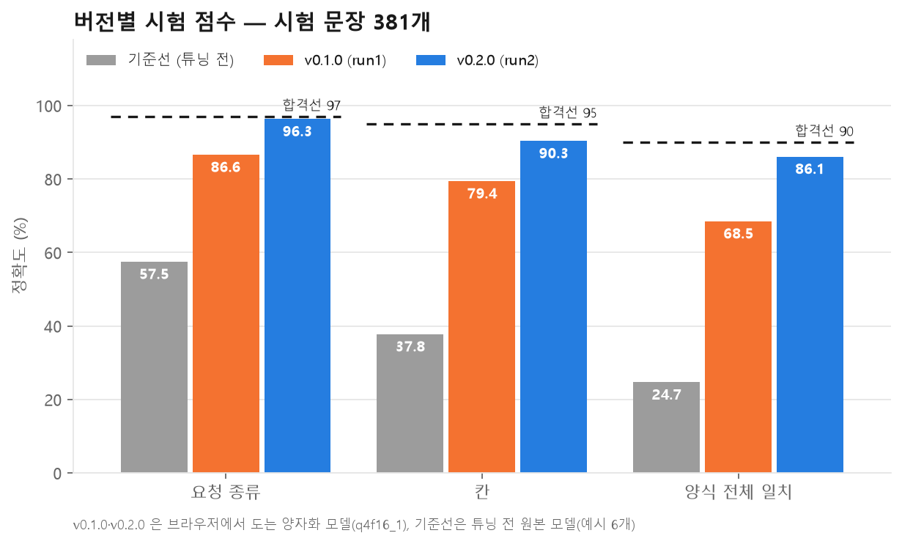
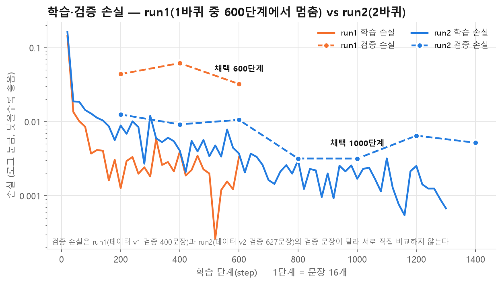
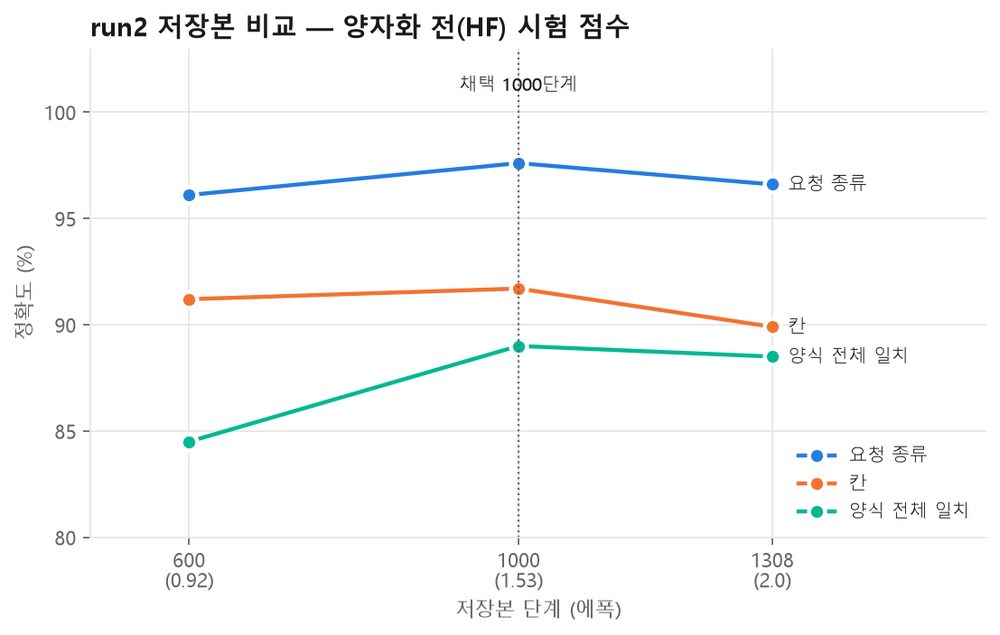
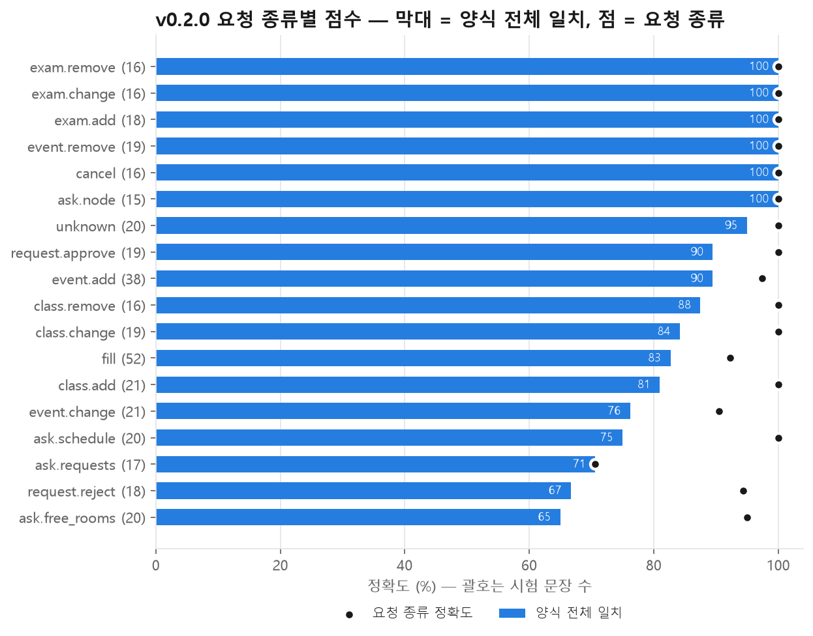

# AI 비서 모델 — 학습·검증 수치 그림

관리자 AI 비서 모델(Gemma 4 E2B + LoRA)의 학습 과정과 시험 점수를 그림으로 정리했다.
수치는 모두 `metrics.json` 에 있고, 그림은 `make_figures.py` 로 다시 그린다.

- 시험 문장: `ml/data/test_human.jsonl` 381개 (라벨 v2)
- 합격선: 요청 종류 ≥ 97% · 칸 ≥ 95% · 양식 전체 일치 ≥ 90% · 형식 오류 ≤ 1% · 위험 오류 ≤ 0.5% · 응답 ≤ 5초

## 한눈에

| 항목 | 기준선 (튜닝 전) | v0.1.0 (run1) | **v0.2.0 (run2, 배포 중)** | 합격선 |
|---|---|---|---|---|
| 요청 종류 | 57.5% | 86.6% | **96.3%** | 97% |
| 칸 | 37.8% | 79.4% | **90.3%** | 95% |
| 양식 전체 일치 | 24.7% | 68.5% | **86.1%** | 90% |
| 형식 오류 | 21.5% | 0.0% | **0.0%** | ≤ 1% |
| 위험 오류 | 2.6% | 0.7% | **0.0%** | ≤ 0.5% |
| 응답 시간 평균 | — | 2.5초 | **2.2초** | ≤ 5초 |

v0.1.0·v0.2.0 은 브라우저에서 실제로 도는 양자화 모델(WebLLM q4f16_1)로 잰 점수다. 기준선은 튜닝 전 원본 모델(예시 6개를 넣은 프롬프트, 양자화 없음)이다.

## 1. 버전별 시험 점수



- v0.2.0 은 v0.1.0 보다 요청 종류 +9.7점, 칸 +10.9점, 양식 전체 일치 +17.6점 올랐다.
- 합격선까지 남은 차이는 요청 종류 0.7점, 칸 4.7점, 양식 전체 일치 3.9점이다. 그래서 아직 시험판(0.x) 번호를 쓴다.

## 2. 학습·검증 손실



- **run1**: 데이터 v1(생성기 문장 + 바꿔 쓰기, 약 3,000 문장)으로 1바퀴(에폭)를 계획했다. 600단계(약 0.9바퀴)에서 멈춰 v0.1.0 이 됐다.
- **run2**: 데이터 v2(직접 쓴 5,262 문장 + 기존 정리본 5,200 = 10,462 문장)로 2바퀴, 1,308단계를 돌았다. 검증 손실은 1,000단계(약 1.5바퀴)에서 가장 낮았다(0.0032). 그 뒤로 다시 오르는데, 과적합이 시작된 신호로 본다. 그래서 1,000단계 저장본을 채택했다.
- 두 run 은 검증 문장이 서로 달라서(v1 400문장, v2 627문장) 검증 손실의 높이를 직접 비교하지 않는다.

## 3. run2 저장본 비교



- 양자화 전(HF) 모델로 저장본 3개를 같은 시험으로 채점했다.
- 검증 손실이 가장 낮은 1,000단계가 시험에서도 세 지표 모두 가장 좋았다. 1바퀴(600단계)보다 양식 전체 일치가 4.5점 높다. 2바퀴 학습이 효과가 있었다.

## 4. v0.2.0 요청 종류별 점수



- 시험기간(exam.*)·일정 삭제·취소·노드 조회는 100% 다.
- 약한 곳은 다음 개선(run3) 대상이다.
  - `ask.free_rooms` 65%: "오후" 같은 시간대 표현을 빠뜨린다.
  - `request.reject` 67%: 거절 사유 칸을 실수한다.
  - `ask.requests` 71%, `ask.schedule` 75%: "이번 주" 같은 기간 표현을 빠뜨린다.
  - `event.change` 76%: 확인 화면 뒤에 고치는 말을 새 요청으로 본다.

## 다시 그리기

```
cd ml
# (학습한 PC 에서) 학습 로그 → metrics.json 의 손실 곡선
uv run python reports/figures/make_figures.py extract --run run1=runs/run1/train.log --run run2=runs/run2/train.log
# metrics.json → PNG 4장. matplotlib 은 의존성에 넣지 않았다 — 그릴 때만 받는다
uv run --with matplotlib python reports/figures/make_figures.py plot
```

## 수치 출처

| 그림 | 출처 |
|---|---|
| 버전별 점수 | `reports/baseline-e2b.json`, `reports/quant-20261128-2.md`(v0.1.0 을 라벨 v2 로 다시 채점한 값), `reports/quant-20261128-2.json` |
| 손실 곡선 | `runs/run1/train.log`, `runs/run2/train.log` (git 밖 — `metrics.json` 의 `curves` 로 옮김) |
| 저장본 비교 | `reports/run-20261128-2.md` |
| 요청 종류별 | `reports/quant-20261128-2.md` 「intent 별」 |
